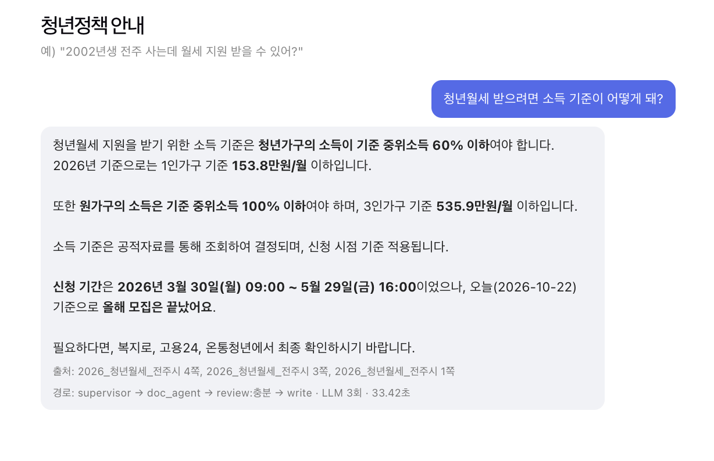
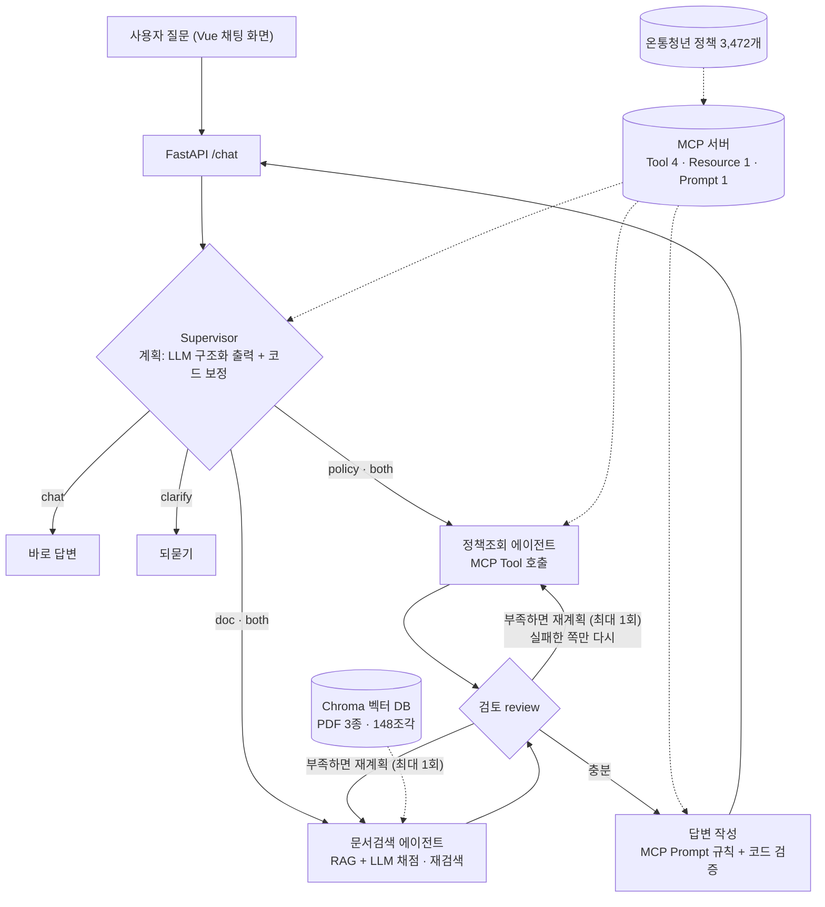
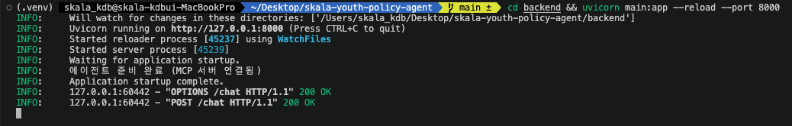
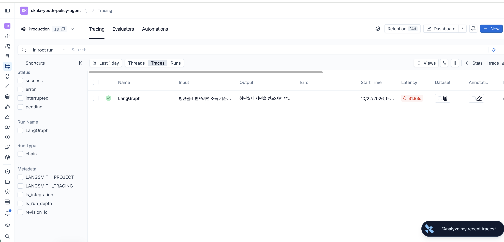

# 청년정책 안내 AI 에이전트

> **SKALA 4기 광주 2반 · G038 · 김단빈**
> AI 서비스 개발 Mini-project (2026.10.20 ~ 10.22)

"2002년생 전주 사는데 월세 지원 받을 수 있어?"처럼 **내 상황을 말하면**, 지금 신청할 수 있는 청년정책과 제도의 세부 기준(소득·재산·신청 기간·신청 방법)을 **근거와 함께** 알려주는 멀티 에이전트 챗봇입니다.



---

## 1. 문제와 구현 기능

### 풀고 싶은 문제

청년정책은 많고(온통청년 등록 정책만 3,472개), 정책마다 대상 나이·지역·신청 기간·소득 기준이 다릅니다. 공고문 PDF는 길고 표가 많아서, "그래서 나는 지금 뭘 신청할 수 있지?"를 알려면 여러 사이트와 문서를 직접 비교해야 합니다. 처음 만든 단순 RAG 챗봇(Step 3)은 이 질문에 제대로 답하지 못했습니다. 문서 조각 3개만 보고 답하다 보니 청년월세 소득 기준을 물으면 "청년가구 60%"만 말하고 원가구 기준은 빠뜨렸고, 2002년생을 "21세"로 계산하거나 이미 마감된 사업을 지금 신청할 수 있는 것처럼 안내했습니다.

### 구현한 기능

| 기능 | 설명 |
|---|---|
| 조건 맞춤 정책 찾기 | 출생 연도·나이·지역(시군구까지)·관심 분야로 온통청년 정책 3,472개 중 **지금 신청 가능한** 정책을 골라 대상·지원 내용·신청 방법과 함께 안내 |
| 제도 세부 기준 설명 | 청년월세(전주시 공고)·청년내일저축계좌(보건복지부)·청년정책집(고용노동부) PDF에서 소득·재산 기준, 신청 기간, 지원 금액을 찾아 설명 |
| 마감 안내와 대안 제시 | 찾는 사업의 모집이 끝났으면 "올해 모집은 끝났어요"라고 알리고 지금 신청 가능한 비슷한 정책을 함께 안내 |
| 되묻기 | "나 받을 수 있는 거 있어?"처럼 정보가 없으면 추측하지 않고 출생 연도·지역·관심 분야를 물어봄 |
| 근거 표시 | 답변 아래에 실제로 참고한 문서 쪽수와 정책 이름, 에이전트가 지나간 경로·LLM 호출 수·걸린 시간을 표시 |
| 안전한 실패 | 서버·LLM 오류가 나도 화면이 멈추지 않고 안내 문구를 보여주며, 원인은 서버 로그에 남김 (내부 오류 내용은 사용자에게 노출하지 않음) |

---

## 2. 구조



질문 하나가 처리되는 흐름은 이렇습니다. Supervisor가 질문을 읽고 어떤 일이 필요한지 계획합니다(바로 답변 / 되묻기 / 정책 목록 / 문서 설명 / 둘 다). "2002년생 전주 사는데 월세 지원 받을 수 있어?"는 정책 목록과 문서 설명이 둘 다 필요하므로 **두 서브에이전트가 동시에** 실행됩니다. 검토 단계에서 결과가 부족하면 LLM이 계획을 고쳐 **실패한 쪽만 다시** 실행하고(동적 재계획), 충분하면 답변을 씁니다.

설계 원칙은 **"판단은 LLM, 실행과 검증은 코드"** 입니다. LLM은 계획·검색 결과 채점·재계획·답변 문장을 맡고, 나이 계산·지역 코드 판단·신청 기간 비교·정책 필터링처럼 정확해야 하는 일은 코드(MCP 도구)가 합니다. 실제로 LLM에게 맡겼던 날짜 비교와 쪽수 표시가 자주 틀려서 코드로 옮겼습니다(아래 5장).

---

## 3. 적용 기술

| 가이드 항목 | 구현 | 위치 |
|---|---|---|
| **Supervisor 패턴** | 질문 분석 → 경로 결정(5가지), 결과 검토 → 재계획. LLM 구조화 출력(`Plan`)이 실패하면 규칙 기반 계획으로 대체 | `backend/agent/supervisor.py` |
| **전문 서브에이전트** | 정책조회(MCP 도구로 조건 검색, 0건이면 키워드 → 분야 → 키워드 없음 순으로 스스로 넓힘), 문서검색(RAG + 채점 + 재검색) | `policy_agent.py`, `doc_agent.py` |
| **LangGraph** | `StateGraph` 7개 노드, 조건부 분기, 두 에이전트 병렬 실행(`operator.add` reducer로 결과 합침) | `backend/agent/graph.py`, `state.py` |
| **동적 재계획** | 검토에서 부족 판정 → LLM이 계획 수정 → 실패한 에이전트만 재실행. 무한 반복 방지: 재계획 1회, 재검색 2회, 전체 25단계, 300초 | `review_node` |
| **MCP Tool** | `get_today`, `calc_age`(생년만 알면 만 23~24세처럼 범위), `resolve_region`(시군구 코드), `find_policies`(나이·지역·키워드·신청 상태) | `mcp_server/server.py`, `tools.py` |
| **MCP Resource** | `policy://catalog`: 데이터 기준일, 분야 목록, 상태별 개수 → Supervisor가 키워드를 고를 때 참고 | 〃 |
| **MCP Prompt** | `policy_answer_prompt`: 답변 규칙 9개(지어내지 않기, 근거 없는 자격 단정 금지, 마감 표시 등)를 서버 한 곳에서 관리 | 〃 |
| **RAG** | PyMuPDF(표는 마크다운으로 추출) → 500자 청킹 → bge-m3 임베딩 → Chroma. 문서명·쪽·사업명·발행기관·적용 지역 메타데이터, 사업명 필터 검색 | `backend/rag/` |
| **Corrective RAG** | 찾은 조각이 질문에 충분한지 LLM이 채점(`Grade`) → 부족하면 더 구체적인 검색어로 다시 검색 | `doc_agent.py` |
| **모듈화 · DI** | LLM·MCP·검색을 `Deps`로 주입 → 테스트는 가짜 부품, 서버는 진짜 부품. `FAKE_TODAY`로 날짜 주입, `LLM_BACKEND`로 OpenAI/Ollama 전환 | `deps.py`, `llm.py` |
| **단위 테스트** | 69개 (도구·그래프 경로·재계획 한도·기간 계산·표 추출·API·평가 채점). LLM·벡터 DB 없이 2초 안에 실행 | `backend/tests/`, `mcp_server/test_tools.py` |
| **LangSmith** | 질문마다 노드·LLM·도구 호출을 트리로 기록(`youth-policy-agent`), 평가 실행은 별도 프로젝트 | `.env` |
| **LLM-as-a-Judge** | gpt-4o가 원본 PDF 쪽과 참고 답안을 보고 정확성·근거성·유용성 1~5점 채점 + 코드 규칙 채점 병행 | `eval/run_eval.py` |

**기술 스택**: Python 3.11, FastAPI, LangGraph 1.2, LangChain, FastMCP 4.1, Chroma, Ollama(bge-m3 임베딩), OpenAI gpt-4o-mini(답변) / gpt-4o(채점), LangSmith, Vue 3 + Vite

---

## 4. 결과

### 4-1. Before / After 평가

같은 LLM(gpt-4o-mini)으로 같은 질문 10개(문서 7 · 정책 2 · 되묻기 1)를 단순 RAG(Before)와 멀티 에이전트(After)에 넣어 비교했습니다. 정답은 원본 PDF에서 직접 확인했습니다(`eval/questions.json`).

| 지표 | Before (단순 RAG) | After (멀티 에이전트) |
|---|---|---|
| **필수 사실 포함률** (코드 채점) | 69% | **94%** |
| 정답 쪽 검색 | 100% | 100% |
| Judge 정확성 (1~5) | 3.8 | **4.5** |
| Judge 근거성 | 3.8 | **4.6** |
| Judge 유용성 | 3.3 | **4.7** |
| 경로 판단 정확도 | - | 100% |
| 평균 시간 | 1.7초 | 5.0초 |
| 평균 LLM 호출 | 1회 | 2.8회 |

결과 파일: `eval/results/summary_20261022_095641.md`

차이가 가장 크게 난 질문은 다음과 같습니다.

- **"2002년생 전주 사는데 월세 지원 받을 수 있어?"**: Before는 5월에 이미 끝난 전주 청년월세를 "월세 지원을 받을 수 있습니다"라고 답했습니다(Judge 2점). 날짜를 모르는 단순 RAG는 이전 실행에서 2002년생을 "19세", "21세"로 계산하기도 했습니다. After는 MCP 도구로 만 23~24세를 계산하고, 전주 청년월세(3/30~5/29) 모집이 끝났다고 알린 뒤 지금 신청 가능한 월세대출·전월세 보증 같은 대안을 안내했습니다(4점).
- **"나 받을 수 있는 거 있어?"**: Before는 질문과 상관없는 특정 대상(자립준비청년 등) 프로그램을 설명했고(2점), After는 되묻기로 출생 연도·지역·관심 분야를 물었습니다(5점).
- **"청년월세 재산 기준은 얼마야?"**: 둘 다 청년가구 1.22억만 말하고 원가구 4.7억을 빠뜨렸습니다. After의 남은 실패 사례입니다(6장).

시간과 LLM 호출은 After가 더 많이 씁니다. 계획·채점·답변을 나눠서 하기 때문인데, 대신 바로 답변과 되묻기는 LLM 1회, 1~2초로 끝나도록 경로를 나눴습니다.

### 4-2. 모델 비교 (같은 에이전트)

| | qwen3:8b (로컬 Ollama) | gpt-4o-mini (OpenAI) |
|---|---|---|
| 질문당 시간 | 33 ~ 77초 | 4 ~ 8초 |
| 계획 품질 | 지역·키워드·출생 연도를 자주 비움 → 코드가 질문에서 채움 (6개 중 출생 3 · 키워드 4 · 지역 2) | 출생 연도·지역은 채우고, 키워드는 가끔 코드가 보충 |
| 규칙 준수 | 쪽수·마감 표시·지역 표시를 들쭉날쭉 지킴 | 더 안정적이지만 지역 표시는 여전히 빠뜨림 → 코드로 보장 |

`.env`의 `LLM_BACKEND`만 바꾸면 두 모델을 오갈 수 있습니다(의존성 주입).

### 4-3. 화면

| 답변 대기 | 서버 시작 (MCP 연결) | LangSmith 트레이스 |
|---|---|---|
|  |  |  |

---

## 5. 검증하며 찾고 고친 것

실제 데이터와 실제 모델로 돌려 보면서 찾은 문제들입니다. 모두 테스트로 고정했습니다.

| 발견한 문제 | 원인 | 해결 |
|---|---|---|
| "전주" 검색에 전주시 정책 0개 | 정책 데이터의 기관명이 "전북특별자치도"로만 저장됨 | 기관명 대신 **시군구 법정동 코드(zipCd)** 로 지역 판단. 광주·전남 통합 코드, 코드 200개 이상이면 전국 정책으로 판단 |
| 나이 제한 Y/N 칸이 실제 값과 안 맞음 | 전수 확인: Y인데 범위 있음 680개, N인데 0~0 63개 | Y/N 무시하고 숫자로만 판단 |
| 정보 없이 "해당될 가능성이 높아요" | 답변 규칙 4번이 그 문장을 그대로 쓰라고 되어 있었음 | 사용자가 밝힌 정보로만 가늠, 없으면 되묻기 |
| 마감된 모집을 신청 가능한 것처럼 안내 | 작은 LLM이 날짜 비교를 자주 틀림 | **코드가** 문서 속 신청 기간 3가지 형식을 찾아 오늘과 비교하고 결과를 사실 목록에 붙임. "뽑히면 ~까지 일해요" 같은 근무 기간은 제외 |
| 본문 쪽수 4개가 모두 틀림 | LLM이 여러 조각 중 어느 숫자가 어느 쪽인지 추적 못 함 | 본문에서 쪽수 제거, 출처는 코드가 검색 결과로 표시 |
| 월세 질문에 신생아 특례 대출 | 같은 분야(전월세)로 걸림 | 질문에 없는 특정 대상(신생아·신혼·장애 등) 전용 정책은 뒤로 |
| 원가구 재산 기준(4.7억) 누락 | PDF 표가 한 줄로 풀려 어느 칸인지 사라짐 | 표를 마크다운 표로 추출 |
| 표 추출 후 "1.22억"이 "122억"으로 | 맥의 PyMuPDF 2.0이 표 칸 글자를 뽑을 때 소수점·쉼표를 밀어냄 | 표에서는 칸 위치만 쓰고 글자는 다시 읽음. **원래 글자의 숫자가 하나라도 사라지면 표 변환을 취소**하는 안전장치 + 전 페이지 테스트 |
| 테스트가 실제 벡터 DB를 건드림 | 평가 모듈을 import만 해도 DB가 열림 | DB 여는 import를 함수 안으로, 테스트에서는 없는 경로를 가리키게 함 |
| LLM 채점자가 맞는 답을 틀렸다고 함 | 채점 모델이 "지금은 2024년"이라고 생각하고, 1억 2천2백만원 ≠ 1.22억으로 판단 | 채점자에게 오늘 날짜와 원문 쪽을 함께 주고, 답변 모델보다 강한 gpt-4o로 채점 |

---

## 6. 한계와 앞으로

**한계와 트레이드오프**

- **정해진 흐름(workflow형) 설계**: 안정적이고 평가가 재현되지만, 흐름 밖의 질문(예: 정책 두 개 비교)에는 유연하지 않습니다. 정책조회를 LLM이 도구를 직접 고르는 방식(ReAct)으로 바꿔 비교해 볼 수 있습니다.
- **LLM이 여전히 정보를 빠뜨림**: "재산 기준"을 물으면 표에 두 칸(청년가구 1.22억 · 원가구 4.7억)이 다 있는데도 한 칸만 말하는 경우가 남았습니다(필수 사실 94%의 나머지).
- **LLM-as-a-Judge의 흔들림**: 같은 답에도 실행마다 점수가 1~2점 달라지고, 채점 이유가 스스로 모순되는 경우도 있었습니다. 그래서 코드 규칙 채점(필수 사실·금지어·정답 쪽)을 함께 보고, 결과 해석은 코드 채점을 우선했습니다. 질문 10개는 통계적으로 작습니다.
- **문서 범위**: PDF 3종만 다루고, 청년월세는 전주시 공고 기준입니다(다른 지역이면 답변에 그 사실을 표시).
- **비용과 속도**: After는 Before보다 LLM을 2.8배 쓰고 3초 느립니다.

**앞으로**

- 답변 스트리밍(첫 글자까지 기다리는 시간 줄이기), 대화 맥락 기억("그럼 서울이면?")
- 지역별 청년월세 공고 추가, 정책 데이터 자동 갱신
- 평가 질문 확대와 반복 실행 평균

### 소감

<!-- 직접 작성: 가장 어려웠던 점, 새로 배운 점, 다음에 다르게 할 점 -->

---

## 7. 실행 방법

```bash
# 1) 환경
python3.11 -m venv .venv && source .venv/bin/activate      # Windows: .venv\Scripts\activate
pip install -r requirements.txt
cp .env.example .env                                       # 키 입력
ollama pull bge-m3                                         # 임베딩 (답변을 로컬로 하려면 qwen3:8b도)

# 2) 데이터 (저장소에는 없음)
python scripts/fetch_policies.py      # 온통청년 정책 → data/raw/policies.json (YOUTH_API_KEY 필요)
#   PDF 3개를 data/raw/에 넣기: 2026_청년월세_전주시.pdf, 2026_청년내일저축계좌_보건복지부.pdf, 2026_청년정책집_고용노동부.pdf
python backend/rag/ingest.py          # 벡터 DB 만들기

# 3) 실행
cd backend && uvicorn main:app --reload --port 8000        # 백엔드 (MCP 서버는 자동으로 함께 뜸)
cd frontend && npm install && npm run dev                  # 화면: http://localhost:5173

# 4) 확인
pytest -q                             # 단위 테스트 69개 (LLM·벡터 DB 불필요)
python scripts/try_agent.py           # 시나리오 6개 실제 실행
python eval/run_eval.py               # Before/After 평가
```

### 폴더 구조

```
backend/
  main.py            FastAPI (/chat 에이전트, /chat/basic 단순 RAG, /health)
  llm.py             LLM 선택 (OpenAI / Ollama)
  agent/             LangGraph 에이전트: graph, state, supervisor, policy_agent, doc_agent, writer, mcp_tools, deps
  rag/               ingest(PDF→벡터 DB), retriever(검색), chain(Before 단순 RAG)
  tests/             단위 테스트
mcp_server/          FastMCP 서버 (Tool 4, Resource 1, Prompt 1) + 정책 판단 함수
frontend/            Vue 3 채팅 화면
eval/                평가 질문·스크립트·결과
scripts/             데이터 수집, 실제 실행 확인 스크립트
docs/                설계 문서, 화면 캡처
```
